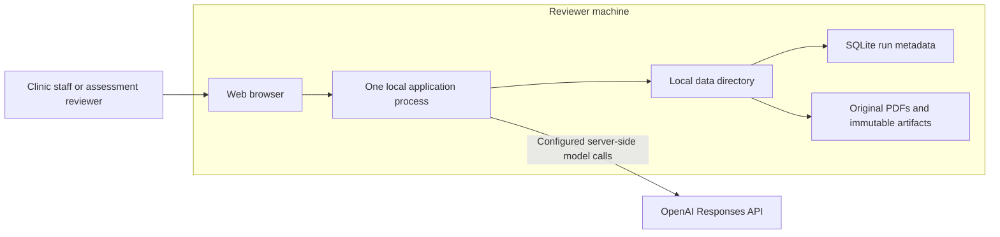
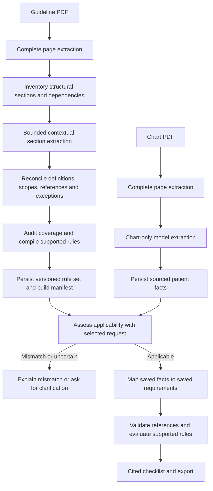
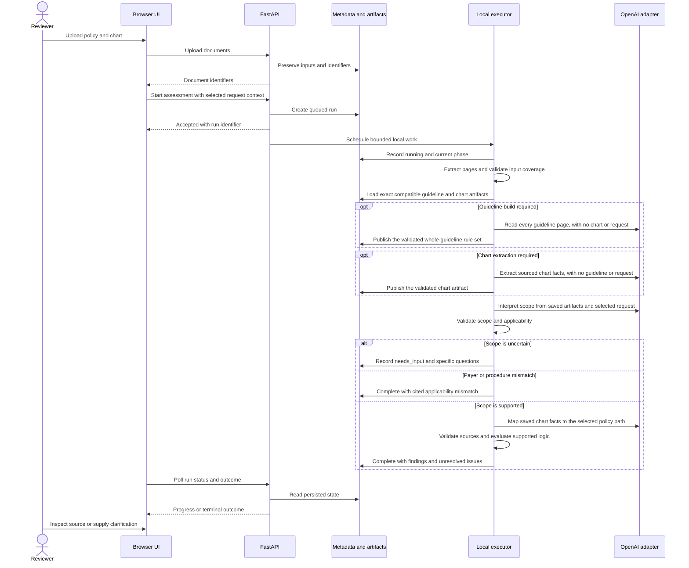
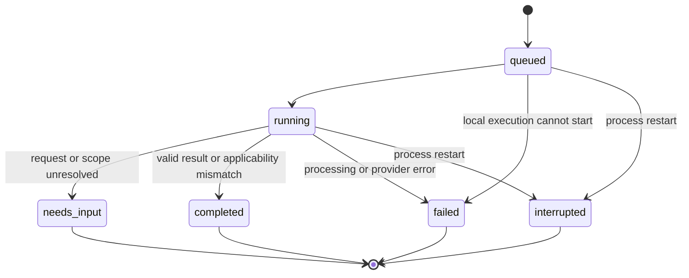

# Aira technical design document

Use an explicit pipeline with durable, inspectable artifacts. Model calls interpret language; ordinary code validates structure, verifies source references, evaluates supported logic, and manages execution. The OpenAI Responses API provides inference through a thin adapter, subject to the [model feasibility decision](model-provider.md). The initial application runs locally for reviewers.

This is the canonical technical design document (TDD), updated October 18, 2026. The [business requirements](requirements/business-requirements.md) define the staff outcome; the [technical requirements](requirements/technical-requirements.md) define normative system contracts. The [implementation plan](implementation-plan.md) groups milestones, and the [work breakdown](work-breakdown.md) owns package dependencies and completion evidence. The [decision record](decisions.md) consolidates the architectural and technical decisions. The design below remains the target; the implementation snapshot distinguishes available components from unfinished integration.

## Implementation snapshot

The rows below describe previously recorded component evidence. The current working tree also contains an unfinished independent-extraction/page-fold refactor. The newly accepted [WP-19 long-document design](plans/long-document-rule-compilation.md) is not verified by those historical test counts; its 100/200-page builds, coverage/reconciliation, durable standalone preparation, and direct-OpenAI release checks remain open.

| Area | Current implementation | Integration boundary |
| --- | --- | --- |
| Application and delivery | `backend/app/main.py` lifespan wires `LocalStore`, provider configuration, and the `WorkflowEngine`; the React workspace uploads, submits, reviews, and exports; locked dependencies, lint/type/tests/build, and GitHub Actions browser checks. | The UI proves saved fixture journeys; live-model journeys remain quota-blocked. |
| Shared records | Strict, frozen schema version `0.1.0` in `backend/app/schemas/`; [contract examples and tests](contracts.md). | Candidate interpretations still require domain validation before use. |
| Evaluation inputs | Hash-pinned development sources, independently reviewed expectations, and a separately reserved pair in `evals/`. | Fixture integrity is verified; live semantic evaluation is pending. |
| Model boundary | `backend/app/llm/`: OpenAI Responses adapter, versioned prompts, `OpenAIStageInterpreter`, access probe, isolated-stage CLI, and the one-pair `app.cli assess` slice; [12 mocked-transport checks](results/stage-interpreter.md) pass. | Live calls failed with insufficient quota. No tested model/default or model-quality claim exists. |
| Native extraction | `backend/app/documents/` performs intake checks, page-accounted native extraction, Tesseract OCR for image-only pages when enabled, and the complete-input gate; [34 checks](results/pdf-extraction.md) pass on the supplied chart and both policy snapshots. | OCR is a runtime fallback requiring the `tesseract` executable; the measured model-input envelope remains WP-15 scope. |
| Provenance and rules | `backend/app/evidence/` and `backend/app/assessment/rules.py` provide pure citation validation, bounded predicates, and three-valued aggregation; [140 checks](results/rules.md) pass. | Semantic support and policy completeness stay reviewed judgments. |
| Candidate conversion | `backend/app/policies/` converts provider candidates into source-valid domain records; 52 checks pass. | Consumed by `OpenAIStageInterpreter`; conversion errors surface as operational stage failures. |
| Persistence | `backend/app/storage/` supplies SQLite, immutable content-addressed files, run history, conservative versioned caching, and a policy rule-set registry keyed by document hash/configuration; [30 checks](results/storage.md) pass. `WorkflowEngine.start()` calls `interrupt_unfinished` and now runs in the application lifespan. | Policy graphs can be reviewed and approved once, then reused for the same document hash/configuration; the engine is a local singleton per process and no shared/clustered store exists. |
| Workflow | `backend/app/assessment/workflow.py` runs bounded single-worker execution with persisted phase artifacts and reuse; [15 controlled-interpreter checks plus 9 rendered-input checks](results/workflow.md) pass over the real parser and store, plus 3 engine runs through the mocked production interpreter. The HTTP app starts the engine in its lifespan. | A live run remains blocked on deferred quota. |
| Exports | `backend/app/assessment/export.py` renders a Markdown evidence checklist from a saved snapshot; `GET /api/assessments/{id}/export` serves JSON or Markdown with 409 on ineligible runs; the UI offers both download actions. | WP-16 parity against live runs remains open. |
| HTTP API and review UI | `backend/app/api/` serves uploads, document metadata/originals/pages, assessment submit/status/export, and the readiness contract; [19 API checks plus 3 health checks](results/http-api.md) pass with the controlled interpreter. The staff workspace in `frontend/src/` consumes them; [9 saved journeys](results/review-ui.md) pass against the fixture interpreter. | WP-16 live parity remains unexercised. |

The health endpoints now use the WP-02 contracts: liveness returns `{"status":"alive"}`; readiness returns 200 only when the store opened, provider configuration resolved, and the engine started — otherwise 503 with `missing_prerequisites` and `provider` stuck at `unverified`. Do not treat a successful shell check or a ready response as live assessment readiness: readiness never verifies model access. Test details and successful CI runs are linked from [implementation evidence](work-breakdown.md#implementation-evidence).

## System context and deployment boundary

The primary actor is a clinic staff member preparing one request. Assessment reviewers use the same workflow on their own machine. Inputs are user-selected PDFs and explicitly recorded request annotations. Outputs are a persisted evidence checklist, source navigation, and exports. There are no automatic connections to an insurer portal, EHR, or policy website in the MVP.

FastAPI serves the built React application and the HTTP API from one origin. The process uses the locked parser dependencies; the data directory preserves runs across restarts. Only the backend reads `OPENAI_API_KEY` and calls the model adapter. The browser receives business results and source content; the API key stays on the server. Model access is a documented prerequisite, and the UI can explain missing configuration without returning fixture answers.

This topology deliberately has one local executor and one metadata store. Its restart behavior is explicit below. A later hosted deployment is outside this local reviewer contract.

## Components and dependency direction

| Component | Owns | Boundary |
| --- | --- | --- |
| React interface | Upload, request clarification, progress, checklist, source navigation, export actions. | Calls the HTTP contract; does not evaluate policy rules. |
| `api/` | Implemented in `backend/app/api/`: input validation, resource IDs, status/source/export routes, liveness and readiness. | Starts work and returns a run ID; does not perform model work inline in an upload request. |
| `documents/` | Native extraction, layout, page accounting, quality checks, and explicit scan rejection. | Returns versioned document records; does not decide policy applicability. |
| `policies/` | Scope/criteria interpretation, section inventory, logical node validation. | Uses typed model results and source references; no patient-specific coverage rules in code. |
| `evidence/` | Facts, context, candidate evidence, citation resolution and conflicts. | Consumes an explicit request and criteria; does not select a payer decision. |
| `assessment/` | Stage order, state transitions, blockers, pure rule evaluation, final result assembly. | Owns orchestration; storage and provider adapters do not advance the workflow themselves. |
| `llm/` | OpenAI Responses API transport, schema adaptation, prompt versions, bounded calls, usage and provider errors. | Implements a narrow model interface; contains no decision aggregation. |
| `storage/` | Metadata repositories, source/artifact files, fingerprints and lineage. | Persists versioned artifacts; does not call parsers or models. |
| `schemas/` | Shared typed data contracts, enums, API/provider shapes. | Has no HTTP, database, or cloud side effects. |
| `observability/` | Run/stage events, timings, usage and error categories. | Records execution facts without making assessment decisions. **Currently no separate module**: these responsibilities are carried by `RunRecord.usage`/`StageUsage` (timings, attempts, tokens, request/response IDs) and the typed error categories on runs and errors. |

Keep the logical evaluator and provenance checks callable without FastAPI, SQLite, or a model provider. Workflow functions receive storage/model/parser dependencies through narrow typed interfaces. Adapters translate service responses into those contracts. The modules live in one application; each table row does not imply another deployable service.

Prompt templates are versioned with code, while uploaded rules and clinical facts are input data. Store provider-compatible flat output schemas separately from additional local invariants when the provider cannot enforce them. A change to either contract updates its version and the affected consumers/evaluations.

## Processing flow

The [WP-19 implementation plan](plans/long-document-rule-compilation.md) specifies the long-document contracts, algorithm, task sequence, persistence, and acceptance. Every section has an explicit disposition; auxiliary summaries/retrieval help gather context without replacing original evidence or exhaustive accounting. Failed/unprocessed required sections prevent complete final publication.

The two extraction flows have document-only typed inputs. They share the configured OpenAI-compatible transport (including a configured LiteLLM gateway), but neither receives the other document, selected request, or staff annotations. They need not run concurrently to be independent. Their persisted artifacts survive assessments and process restarts. Assessment uses saved artifacts rather than re-reading documents through the model. Evidence mapping returns findings referencing existing fact IDs and cannot invent additional patient facts.

Artifact reuse keys contain source content, actual extraction content/parser settings, the relevant extraction prompt/schema, provider endpoint/transport/model, and inference configuration. Policy keys exclude chart, request, annotations, chart prompt, and assessment prompt versions. Chart keys exclude policy and assessment settings. A changed document or relevant extraction version creates a new artifact; a changed assessment does not. Rejected rule sets are never reused. Technically validated drafts may be reused without implying human approval. Legacy request-specific policy artifacts are not compatible with this whole-guideline extraction version.

Validate each artifact before publication and after rebinding citations to an identical re-upload's document/extraction IDs. Preserve original immutable payloads and the exact artifacts consumed by each run. Inventory all guideline sections; unsupported conditional/procedure logic remains a blocker rather than being dropped to fit a patient. Exact-span validation establishes provenance, not semantic completeness; live evaluation remains required.

## Request and run lifecycle

The [TRD](requirements/technical-requirements.md) owns exact endpoint contracts and error envelopes. The interaction is asynchronous at the HTTP boundary even though execution remains in one local process.

`status` describes execution; `phase` identifies work within `running`; the assessment outcome describes what the documents establish. Keep these fields separate. Assessment phases include `extracting`, `interpreting_policy`, `extracting_chart`, `checking_applicability`, `mapping_evidence`, `validating`, and `evaluating`. WP-19 introduces a separate durable document-build lifecycle with section progress and bounded inventory/extraction/reconciliation/audit/compile work; its API/schema amendments are LD-02 work, not already verified endpoints.

`needs_input` stops the current attempt. Clarification, retry, or changed inputs create a new run with `parent_run_id` and preserved annotations; they do not rewrite the old result. The MVP accepts request-metadata corrections. An explicit selected value and reason can resolve metadata disagreement while the source conflict stays visible. It provides no manual clinical `met` override: changed clinical evidence comes from a newly uploaded source. A completed mismatch contains supporting scope evidence and no medical-necessity aggregate. A completed applicable assessment may still be `review_required`, contain contrary evidence, or expose gaps. `completed` means processing reached a valid outcome, not that the request is approved or its requirements are satisfied.

Operational failures can occur in every running phase and produce a `failed` run with an actionable error. On startup, identify unfinished local executions and mark them `interrupted`; do not silently claim they resumed. Commit artifact files before marking a stage complete, and publish metadata only for successfully persisted artifacts so a process crash cannot leave a reusable completed-stage record pointing to missing output.

## Domain records

| Record | Required information |
| --- | --- |
| Document | Stable ID, SHA-256 of original bytes, role, filename, page count, extraction version, page/block text and optional coordinates, per-page quality issues. |
| Source span | Document hash/ID, one-based page number, block/span IDs or offsets, exact excerpt, extraction version, optional bounding boxes. A cross-page passage contains multiple spans. |
| Request | One selected procedure and available code, anatomical target/laterality where relevant, payer, plan, service date, source references, and separate user annotations. Preserve unresolved fields. |
| Policy | Source document, policy identifier, title, revision date, effective period if stated, scope and exclusions, criteria, logical nodes, root reference, relevant-section inventory, and unresolved interpretation. |
| Criterion | Stable within-version ID, source wording/spans, interpreted requirement, supported predicate or narrative question, required context, and any exception references. |
| Chart fact | Source spans, documented proposition, value/unit where present, polarity, event date, documentation date, uncertainty and conflicting alternatives. |
| Finding | Criterion ID, evidence references, status, rationale, unresolved reasons, and evaluator inputs. An empty evidence set cannot establish a positive finding. |
| Run | Input/request fingerprints, parser/prompt/schema versions, provider/model and SDK, inference settings, stage state, artifacts, timing/usage, failure details, and result. |

Dates are not interchangeable. A document signature, observation, proposed service, policy revision, and policy effective date retain their own meanings. Never repair inconsistent dates silently. Summarized clinical facts keep their summary provenance; a claimed normal CBC does not create laboratory values absent from the chart.

Match evidence to the selected request, anatomical target, and relevant time period. Evidence for the opposite side or a different procedure cannot silently satisfy a requirement. If assessing readiness as of a particular date, record that cutoff and flag evidence that was not yet available. Do not infer a service date from submission date or today's date.

## Policy structure

The model's wire format uses flat records: `nodes` contain an ID, a kind (`all`, `any`, or `criterion`), and references to child IDs or a criterion ID. The current policy contract identifies one root. WP-19 must amend/version the whole-guideline envelope to retain distinct procedure/scope paths, with one root per evaluated path or faithful source-supported guards. Unrelated branches cannot satisfy the selected request. Flat nodes avoid a recursive provider schema. Local validation rejects duplicate IDs, unknown references, cycles, unreachable nodes, empty logical groups, and unsupported operators. Use ordinary typed domain objects internally after validation.

Preserve the source passage behind every interpreted requirement and connective. Keep headings, definitions, applicability restrictions, and policy-wide exceptions attached to the selected path. A boolean tree alone does not prove that the extractor captured the whole policy. Account for relevant sections with linked requirements or explicit explanations of their role; retain unclassified conditions and unresolved interpretation as independent blockers. Even a true rule tree cannot produce `documented requirements satisfied` while a relevant governing condition is unresolved. This gate catches known gaps; independent annotated evaluations are still needed to discover conditions the extractor missed entirely.

The initial evaluator supports AND/OR groups and carefully bounded numeric/date predicates with explicit units and context. Narrative conditions are assessed with cited evidence and remain model judgments. Implement only tested comparisons; ambiguous units, temporal relationships, conditional exceptions, or unsupported language become review issues. Do not build a universal policy language interpreter for the take-home.

For the example vein policy, preserve the persistent-symptom branch containing the compression requirement instead of attaching compression to every indication. Also preserve the broader symptomatic wording and exceptions for review. This example guides tests, never procedure-specific production conditions.

## Finding and aggregation semantics

Use separate fields for evidence status and logical value:

| Evidence status | Logical value | Meaning |
| --- | --- | --- |
| `met` | true | Cited evidence supports the exact requirement and required context. |
| `not_met` | false | Cited contrary evidence establishes failure of the exact requirement. |
| `missing` | unknown | Relevant documentation was not found in the successfully processed input. |
| `conflicting` | unknown | Incompatible evidence remains unresolved. |
| `needs_review` | unknown | Interpretation or supported computation cannot determine the requirement. |

Absence is not a negative finding. Negation must match the policy question: a documented absence of symptoms may support a requirement that symptoms be absent, or contradict a requirement that symptoms be present. It is not intrinsically true or false.

Evaluate AND as false if any child is false, true only if every child is true, and unknown otherwise. Evaluate OR as true if any child is true, false only if every child is false, and unknown otherwise. Preserve every child status and unresolved reason even when the group's logical value is known. Show which branch supports a true OR result; do not tell staff to collect documentation for every unneeded alternative.

For example, `false AND unknown` is false while the missing documentation remains visible. `true OR unknown` is true while the alternate branch remains unresolved. A conflict in the evidence used to justify the true branch makes that branch unknown. This prevents a summary label from erasing evidence quality.

Keep scope separate from findings. Only a source-supported exclusion can make a branch inapplicable; the model cannot use `not_applicable` as an escape from missing evidence. Unresolved applicability, exclusions, mandatory conditions, or policy-completeness issues block a favorable overall readiness result independently of the tree's logical value.

Overall display states are: applicability mismatch, scope needs clarification, documented requirements satisfied, documentation gaps or contrary evidence, and review required. Processing failed or interrupted is a workflow state, never a coverage finding. A false result and unresolved issues may coexist and must both be shown. No weighted score, majority vote, model confidence average, or percentage of criteria substitutes for policy logic.

## Validation boundaries

Treat model output as a candidate interpretation. Validate its schema, domain invariants, citations, and allowed state transitions before it affects a result. Resolve excerpts against the preserved extraction with narrowly defined whitespace normalization; do not fuzzy-match an invented quote to a similar passage. Check document identity, page boundaries, and span membership. Verify numeric values and units against their evidence when a deterministic predicate uses them.

Source existence is necessary but does not establish that the passage supports the claim. Semantic support, negation, relevance, and completeness require reviewed evaluation cases. The interface exposes these judgments and their sources so staff can challenge them. Untrusted document instructions are content, not permissions to invoke tools or change application rules; the model has no submission or browsing tools.

Each extracted page also carries an `extraction_score`: the ratio of retained native characters to source characters. A run with no extracted chart facts receives a blocking completeness issue and cannot be marked satisfied. Medical-term context matching can use the small reviewed synonym helpers in `backend/app/evidence/synonyms.py`; they are bounded helpers, not a clinical ontology. The working tree has provisional context limits, `backend/app/assessment/chunking.py` page-range helpers, and a page-index/serial-fold prototype in `policies/pages.py` and the interpreter/workflow. These do not establish WP-19 support. Replace or extend them through structural chunk planning, explicit dependencies, immutable local extraction, reconciliation, coverage audit, and measured whole-build limits. A short excerpt cannot justify skipping a section, and an accumulated graph cannot be assumed to preserve earlier rules after repeated model rewrites.

Use the selected model's verified structured-output mechanism, then validate locally with strict Pydantic contracts. Provider schema support is narrower than application validation; bounds, cross-record references, and tree invariants remain code responsibilities. An invalid response can receive one bounded repair attempt with validation feedback. A persistent error ends that stage visibly.

## Execution and persistence

Expose a small API: upload documents; start an assessment for document IDs and request metadata; read status/results; open source pages; and download an export. Keep document role and run ownership explicit in every lookup. Proposed endpoint shapes are `POST /api/documents`, `POST /api/assessments`, `GET /api/assessments/{id}`, and document/source and export routes. Finalize response contracts before the UI integration.

Use a single-process executor with bounded concurrency for the local MVP, plus SQLite records and immutable stage artifacts on disk. Return a run ID promptly and let the browser poll progress. Persist the status/phase transitions defined in [the run lifecycle](#request-and-run-lifecycle). A process restart marks unfinished local executions interrupted; offer a new run using valid saved artifacts. Do not imply a durable distributed queue exists.

Fingerprint reusable artifacts with input bytes plus parser, prompt, schema, model, and relevant configuration versions. Include selected request and user annotations in assessment identity. Cache only completed, validated artifacts. A retry cannot overwrite a prior final result or silently reuse output from a changed policy. Store actual outputs: a fixed temperature does not guarantee reproducible model responses.

Policy interpretation results are also retained in a separate rule-set registry keyed by the policy document hash and configuration fingerprint. A model-generated graph is stored as a draft after technical validation. Later assessments reuse compatible drafts or approved rule sets without repeating extraction. Approval records human review separately and is never implied by reuse or a successful run.

The implemented storage API uses separate role-scoped document IDs even when identical bytes share a blob. The original submitted fingerprint remains immutable; derived request context is saved in each run snapshot and participates in stage cache keys. Exact extraction revisions, upstream artifact identities, output schema, and validator version also participate. Files publish atomically before SQLite metadata, and reads verify their hashes. See the [storage verification record](results/storage.md) for APIs and failure tests. The workflow must validate candidate semantics before calling the artifact publication API.

Bound provider retries for transient errors with exponential backoff and jitter, and an overall stage deadline. Avoid retry multiplication between SDK and application layers. Authentication errors, invalid schemas, and unsupported input require corrective action rather than repeated calls. Record attempts and distinguish parser failure, access failure, throttling, timeout, refusal, invalid output, and citation failure. All-page accounting and complete model responses are prerequisites for an ordinary completed assessment.

Liveness reports that the HTTP process is serving. Readiness reports local dependencies and configuration needed to accept work; it does not promise current model access or trigger repeated paid inference. Record the outcome/time of a separately invoked live access check when available. Both stale access and mid-run provider failure remain possible and use the ordinary error path.

## Later hosting

The initial MVP uses OpenAI for language interpretation and native PDF extraction locally. Unsupported scans or unusable image-only pages receive an explicit failure; they are never silently omitted. Adding OCR needs a justified scope decision and extraction/failure verification. The [provider decision](model-provider.md) owns the active integration boundary.

Hosted deployment, a shared database, and extra workers are outside the current scope. Managed retrieval and autonomous agent orchestration have no demonstrated requirement.
