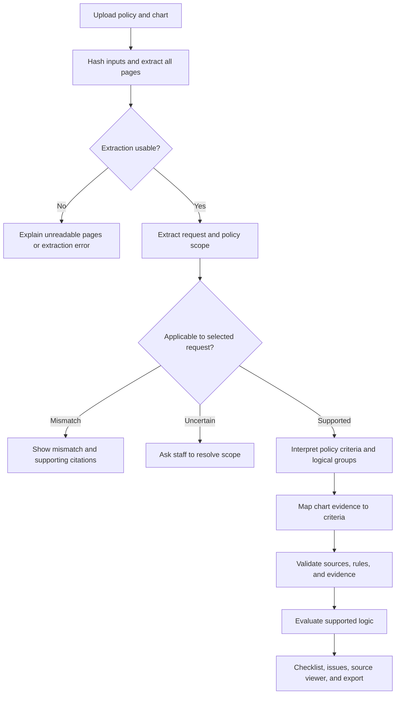

# Aira application architecture

Use an explicit pipeline with durable, inspectable artifacts. Model calls interpret language; ordinary code validates structure, verifies source references, evaluates supported logic, and manages execution. AWS Bedrock provides inference through a thin adapter. The initial application runs locally for reviewers.

This is the design to implement, not a description of deployed software. [The implementation plan](implementation-plan.md) defines milestones and remaining experiments.

## Processing flow

Bedrock serves the scope, policy interpretation, and evidence stages. Start with page-tagged full text inside explicit input limits. Layout extraction preserves tables and block positions. A future retrieval adapter must demonstrate evidence recall before replacing the full-context baseline.

## Domain records

| Record | Required information |
| --- | --- |
| Document | Stable ID, SHA-256 of original bytes, role, filename, page count, extraction version, page/block text and optional coordinates, per-page quality issues. |
| Source span | Document hash/ID, one-based page number, block/span IDs or offsets, exact excerpt, extraction version, optional bounding boxes. A cross-page passage contains multiple spans. |
| Request | One selected procedure and available code, anatomical target/laterality where relevant, payer, plan, service date, source references, and separate user annotations. Preserve unresolved fields. |
| Policy | Source document, policy identifier, title, revision date, effective period if stated, scope and exclusions, criteria, logical nodes, root reference, relevant-section inventory, and unresolved interpretation. |
| Criterion | Stable within-version ID, source wording/spans, interpreted requirement, supported predicate or narrative question, required context, and any exception references. |
| Chart fact | Source spans, documented proposition, value/unit where present, polarity, event date, documentation date, uncertainty and conflicting alternatives. |
| Finding | Criterion ID, evidence references, status, rationale, unresolved reasons, and evaluator inputs. An empty evidence set cannot establish a positive finding. |
| Run | Input/request fingerprints, parser/prompt/schema versions, model/profile and region, inference settings, stage state, artifacts, timing/usage, failure details, and result. |

Dates are not interchangeable. A document signature, observation, proposed service, policy revision, and policy effective date retain their own meanings. Never repair inconsistent dates silently. Summarized clinical facts keep their summary provenance; a claimed normal CBC does not create laboratory values absent from the chart.

Match evidence to the selected request, anatomical target, and relevant time period. Evidence for the opposite side or a different procedure cannot silently satisfy a requirement. If assessing readiness as of a particular date, record that cutoff and flag evidence that was not yet available. Do not infer a service date from submission date or today's date.

## Policy structure

The model's wire format uses flat records: `nodes` contain an ID, a kind (`all`, `any`, or `criterion`), and references to child IDs or a criterion ID. The policy identifies one root. This avoids a recursive provider schema. Local validation rejects duplicate IDs, unknown references, cycles, unreachable nodes, empty logical groups, and unsupported operators. Use ordinary typed domain objects internally after validation.

Preserve the source passage behind every interpreted requirement and connective. Keep headings, definitions, applicability restrictions, and policy-wide exceptions attached to the selected path. A boolean tree alone does not prove that the extractor captured the whole policy. Account for relevant sections with linked requirements or explicit explanations of their role; retain unclassified conditions and unresolved interpretation as independent blockers. Even a true rule tree cannot produce `documented requirements satisfied` while a relevant governing condition is unresolved. This gate catches known gaps; independent annotated evaluations are still needed to discover conditions the extractor missed entirely.

The initial evaluator supports AND/OR groups and carefully bounded numeric/date predicates with explicit units and context. Narrative conditions are assessed with cited evidence and remain model judgments. Implement only tested comparisons; ambiguous units, temporal relationships, conditional exceptions, or unsupported language become review issues. Do not build a universal policy language interpreter for the take-home.

For the example vein policy, preserve the persistent-symptom branch containing the compression requirement instead of attaching compression to every indication. Also preserve the broader symptomatic wording and exceptions for review. This example guides tests, never procedure-specific production conditions.

## Finding and aggregation semantics

Use separate fields for evidence status and logical value:

| Evidence status | Logical value | Meaning |
| --- | --- | --- |
| `met` | true | Cited evidence supports the exact requirement and required context. |
| `not_met` | false | Cited contrary evidence establishes failure of the exact requirement. |
| `missing` | unknown | Relevant documentation was not found in the successfully processed input. |
| `conflicting` | unknown | Incompatible evidence remains unresolved. |
| `needs_review` | unknown | Interpretation or supported computation cannot determine the requirement. |

Absence is not a negative finding. Negation must match the policy question: a documented absence of symptoms may support a requirement that symptoms be absent, or contradict a requirement that symptoms be present. It is not intrinsically true or false.

Evaluate AND as false if any child is false, true only if every child is true, and unknown otherwise. Evaluate OR as true if any child is true, false only if every child is false, and unknown otherwise. Preserve every child status and unresolved reason even when the group's logical value is known. Show which branch supports a true OR result; do not tell staff to collect documentation for every unneeded alternative.

For example, `false AND unknown` is false while the missing documentation remains visible. `true OR unknown` is true while the alternate branch remains unresolved. A conflict in the evidence used to justify the true branch makes that branch unknown. This prevents a summary label from erasing evidence quality.

Keep scope separate from findings. Only a source-supported exclusion can make a branch inapplicable; the model cannot use `not_applicable` as an escape from missing evidence. Unresolved applicability, exclusions, mandatory conditions, or policy-completeness issues block a favorable overall readiness result independently of the tree's logical value.

Overall display states are: applicability mismatch, scope needs clarification, documented requirements satisfied, documentation gaps or contrary evidence, and review required. Processing failed or interrupted is a workflow state, never a coverage finding. A false result and unresolved issues may coexist and must both be shown. No weighted score, majority vote, model confidence average, or percentage of criteria substitutes for policy logic.

## Validation boundaries

Treat model output as a candidate interpretation. Validate its schema, domain invariants, citations, and allowed state transitions before it affects a result. Resolve excerpts against the preserved extraction with narrowly defined whitespace normalization; do not fuzzy-match an invented quote to a similar passage. Check document identity, page boundaries, and span membership. Verify numeric values and units against their evidence when a deterministic predicate uses them.

Source existence is necessary but does not establish that the passage supports the claim. Semantic support, negation, relevance, and completeness require reviewed evaluation cases. The interface exposes these judgments and their sources so staff can challenge them. Untrusted document instructions are content, not permissions to invoke tools or change application rules; the model has no submission or browsing tools.

Use the selected model's verified structured-output mechanism, then validate locally with strict Pydantic contracts. Provider schema support is narrower than application validation; bounds, cross-record references, and tree invariants remain code responsibilities. An invalid response can receive one bounded repair attempt with validation feedback. A persistent error ends that stage visibly.

## Execution and persistence

Expose a small API: upload documents; start an assessment for document IDs and request metadata; read status/results; open source pages; and download an export. Keep document role and run ownership explicit in every lookup. Proposed endpoint shapes are `POST /api/documents`, `POST /api/assessments`, `GET /api/assessments/{id}`, and document/source and export routes. Finalize response contracts before the UI integration.

Use a single-process executor with bounded concurrency for the local MVP, plus SQLite records and immutable stage artifacts on disk. Return a run ID promptly and let the browser poll progress. Persist transitions such as queued, extracting, checking applicability, assessing, completed, failed, and interrupted. A process restart marks unfinished local executions interrupted; offer a new run using valid saved artifacts. Do not imply a durable distributed queue exists.

Fingerprint reusable artifacts with input bytes plus parser, prompt, schema, model, and relevant configuration versions. Include selected request and user annotations in assessment identity. Cache only completed, validated artifacts. A retry cannot overwrite a prior final result or silently reuse output from a changed policy. Store actual outputs: a fixed temperature does not guarantee reproducible model responses.

Bound provider retries for transient errors with exponential backoff and jitter, and an overall stage deadline. Avoid retry multiplication between SDK and application layers. Authentication errors, invalid schemas, and unsupported input require corrective action rather than repeated calls. Record attempts and distinguish OCR/parser failure, access failure, throttling, timeout, refusal, invalid output, and citation failure. All-page accounting and complete model responses are prerequisites for an ordinary completed assessment.

## AWS responsibilities

The MVP uses Bedrock for language interpretation. Pagewise synchronous Textract is the optional OCR path to evaluate; it can accept bytes without S3. A later asynchronous path for longer scans introduces S3 and job coordination. Credentials and model access are explicit reviewer prerequisites. No infrastructure provisioning is part of the current documentation work.

A later hosted version can package the same API/UI image on ECS Fargate, store immutable documents and artifacts in S3, and move shared metadata to Postgres. Add SQS and a worker when execution must survive restarts or multiple workers. Use CloudWatch for service signals, then evaluate Step Functions only if cross-service retries and workflow recovery justify it. Bedrock Knowledge Bases, OpenSearch, EKS, and autonomous agent orchestration have no demonstrated requirement in the current scope. See [AWS research](aws.md) for service details and the decision rationale.
