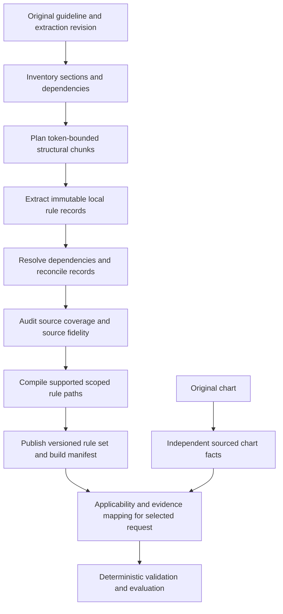

# WP-19 implementation plan

This is the execution plan for [long-document rule-set compilation](../features/19-long-document-rule-compilation.md), derived from the [October 18 research](../research/long-document-rule-extraction.md) and the user's architecture decisions. BR-013/TR-019 own the requirement; WP-19 owns tasks/acceptance; the [work breakdown](../work-breakdown.md) owns status. The [October 19 implementation record](../results/wp19-implementation.md) maps delivered modules, controlled checks, and open release evidence. The initial gap analysis is historical.

## Historical starting point and gaps

Inspect current files and `git status` before editing. The working tree contains unfinished changes beyond this documentation; preserve them and establish the current check results. Existing reusable components include `documents/native.py`, strict schemas, `CitationResolver`, candidate conversion, the pure evaluator, `LocalStore`, the configured inference adapter, and the assessment UI/export flow.

`DocumentInputs` and chart/policy artifact support are present in the working tree. `assessment/chunking.py` is a character-based page-range helper, not a complete section orchestrator. `policies/pages.py`, `select_policy_pages`, `apply_policy_page`, and `WorkflowEngine._policy_by_page` formed an excerpt-index/serial-fold prototype; that workflow method has been replaced. It classifies short page excerpts, can skip pages, and repeatedly regenerates an accumulated graph. These are implementation gaps to assess, not the accepted design: missing rules may occur outside excerpts; lists span pages; remote exceptions need reconciliation; repeated full-graph rewriting can lose earlier conditions or exceed output budgets. A skipped-page warning or failed merge retained as a partial graph does not establish complete guideline preparation.

## Target flow

All stages use explicit Python orchestration and typed boundaries. Concurrency is optional and bounded. No autonomous-agent framework, retrieval server, new queue service, or cloud deployment is required. Use the current adapter to call direct OpenAI or an explicitly configured OpenAI-compatible `/v1` endpoint.

## Contracts to implement in LD-02

Amend/version the shared schemas before consumers. Preserve old saved assessments; migrate compatible records or reject incompatible reuse with an explicit version boundary. Do not silently reinterpret old request-specific policies as whole-guideline artifacts.

| Target record | Required content and invariants |
| --- | --- |
| Document/section inventory | Original document hash/extraction revision; stable block/section IDs; parent headings/list ancestry; table headers/footnotes; page/spans; section kind and classification rationale. Every source block is accounted for, including blank/non-normative content. |
| Chunk plan | Primary section/span IDs; original source identities; auxiliary context IDs; actual serialized input token count; output reservation; planner/tokenizer version; dependency candidates. Primary text and supplementary context are distinguishable. |
| Section extraction | Immutable local rules, concepts/definitions, scope conditions, numeric/date predicates, logical relationships, exceptions, unresolved reference records, exact sources, and interpretation issues. Local IDs are namespaced deterministically by section. |
| Dependency/reconciliation record | References to both source records; resolution kind and target; evidence for canonicalization or scope attachment; unresolved/conflicting states; input/output hashes and resolver version. Similar wording alone must not collapse different procedure/plan/time meanings. |
| Coverage/audit report | Source-to-record and record-to-source mappings; unprocessed/failed/unresolved sections; per-section disposition; audit discrepancies and their disposition; measured denominators. Mechanical coverage is not a semantic-completeness score. |
| Compiled rule set | Policy metadata; source-bound variables/predicates; shared definitions; named procedure/scope paths and their roots; supported logical nodes; exclusions; review blockers; sources; references to build/coverage artifacts. Preserve source-defined conjunctions and alternatives. |
| Build manifest | Build/parent IDs, immutable input/configuration fingerprints, status/phase, section progress, intermediate artifacts, selected final artifact, usage/errors, and human review state. Record actual generation settings on each artifact. |

Keep the evaluator's existing `all`/`any`/`criterion` operations and tested predicates as the initial executable language. Extend the versioned policy contract to represent multiple scoped paths, or faithfully encode source-supported scope guards; never combine unrelated procedure requirements into a global AND or allow an unrelated true OR branch to establish readiness. If faithful representation requires an unsupported operation, retain a blocking interpretation issue. No LLM-generated Python/eval execution or source-free “common-sense” coverage rules.

Define standalone build start/status/result/retry/rebuild interfaces for policy and chart preparation before UI wiring. Prefer one role-scoped document-build contract over separate orchestration engines. Freeze exact route names, payloads, state transitions, errors, and OpenAPI tests in TR-013 during LD-02; they are not implemented public endpoints merely because this plan names the capability. Assessments must pin an exact completed artifact/version; a retry or new “latest” build cannot change a saved assessment.

## Extraction and reconciliation algorithm

1. **Inspect and parse.** Retain original bytes, every page, layout, and extraction-method/quality metadata. Unusable input fails before interpretation. Decide how to raise the existing page envelope to the 200-page target through measured parser and intake checks.
2. **Inventory.** Identify complete structural sections, definitions, exclusions, scope, attachments, and explicit references. A bounded index pass can propose labels and dependencies; labels from 500-character excerpts cannot authorize omission of the rest of a page. Empty/unclassified sections remain queued for full inspection.
3. **Plan.** Prefer headings/list/table boundaries, then split oversized sections by stable spans. Carry parent introductions and table headers. Use the selected model's tokenizer where available and test a conservative fallback. Count rendered context, schema/instructions, and output reservation; a single oversized atomic unit must be split faithfully or rejected explicitly. There is no universal pages-per-call constant.
4. **Gather context.** Attach parent scope, relevant definitions, adjacent continuation text, and referenced original spans. Record every dependency. If context itself exceeds budget, partition it through a recorded hierarchy and reconcile explicitly. Summaries may route work but cannot serve as sole rule evidence.
5. **Extract.** Run bounded calls per primary section, validate schema/spans/IDs, and atomically save local records. Constrained output shape does not prove semantics. Refusal, truncated output, or persistent validation errors are failed work, never empty successful extractions. Separate exact overlap deduplication from model-assisted concept resolution.
6. **Reconcile.** Build explicit relationships between local records. Resolve remote definitions and exceptions using original passages; preserve procedure, payer, plan, anatomy, and temporal scope. Process bounded groups and retain records/edges rather than feeding an ever-growing global JSON graph into each page call. Keep conflicts, absent referenced material, cycles, and ambiguous attachments visible.
7. **Audit.** Compare original sections against extracted records with bounded omission checks; reconcile each discrepancy against source. Audit feedback cannot silently delete mandatory rules or change independent expectations. A second model or repeated pass is supplementary evidence, not ground truth.
8. **Compile and publish.** Validate all sources, references, graph structure, path scope, supported comparisons, and the coverage ledger. A reusable final artifact requires all required extraction/audit work to finish. Supported but unresolved semantics may produce a completed draft with review blockers; operationally missing or failed sections prevent publication as a completed rule set. Human approval is explicit and separate from technical reuse.

Whole-document extraction can remain a measured small-document baseline behind explicit limits. No switch in strategy may silently change completeness semantics. Retrieval can locate dependencies; it cannot replace the exhaustive source ledger with top-k relevance.

## Durable execution and invalidation

- Independent policy identity excludes charts, requests, annotations, chart prompts, and assessment-only prompts. Independent chart identity excludes policies and assessment context. Include source/extraction content, relevant parser/planner/tokenizer, inventory/extraction/reconciliation/audit/compiler contracts and versions, actual endpoint/transport/model/SDK, inference settings, and upstream artifact hashes.
- Track which stage consumes each setting: an assessment prompt change leaves extraction reusable; a compiler change can reuse compatible section outputs but requires recompilation. A changed definition invalidates dependent resolution/audit/compiled artifacts even when their primary text is unchanged. Replan if altered context changes a chunk's meaning or boundaries.
- Save original generation provenance with each artifact. Rebinding citations to an identical upload requires exact text/layout checks and a new binding record; keep the original payload and extraction identity available.
- Maintain a single active local build per compatible key with bounded waiters. Persist work before publishing completion. Mark unfinished work interrupted after restart; a user retry creates a linked attempt that may reuse completed compatible sections. A timeout cannot guarantee no provider work or duplicate billing.
- Bound per-call input/output, concurrent calls, section attempts, repair/audit iterations, total build calls/tokens, and wall-clock duration. Account for failed attempts, audit, retries, and reconciliation in usage. Exhaustion returns a named operational failure with the section/build IDs.
- Rejected/corrupt artifacts cannot be consumed. An explicit new build/version can replace them prospectively; never mutate a prior final artifact, auto-approve a repair, or publish a partial fallback as complete.

## Execution slices and verification

| Slice | Tasks | Suggested ownership and files | Required check |
| --- | --- | --- | --- |
| Sources and contracts | LD-01–LD-02 | Evaluation/schema integration: `evals/`, `tests/fixtures/`, `schemas/`, `docs/contracts.md`, TRD. | Independent expectations, strict contracts, migrations, provider-isolated inputs, approved API contract. |
| Planner and local extraction | LD-03–LD-04 | Documents/model integration: `documents/`, a focused planner module, `llm/prompts.py`, interpreter/conversion. | Cross-page list/table preservation; fully accounted source ledger; bounded controlled adapter calls. |
| Reconciliation and compilation | LD-05–LD-06 | Domain: `policies/`, `evidence/`, pure compiler/evaluator boundaries. | Distant definition/exception, contradictory terms, multiple procedures, wrong branch, missing external reference, edge mutation and omitted-condition controls. |
| Durable build service | LD-07 | Integration/storage: `assessment/`, `storage/`; one owner for schemas/migrations. | Atomic writes, coalescing, interruption, linked retry, invalidation, rejection/corruption, and immutable prior runs. |
| Staff workflow and routing | LD-08 | API/frontend: routes, source/coverage/build views, exports, saved browser journeys. | Prepare policy without chart; inspect/retry/pin artifacts; every model operation follows selected endpoint/key; health/status make zero inference calls. |
| Evaluation and delivery | LD-09–LD-10 | Evaluation/integration: result report, limits, launch instructions, design note. | Full deterministic checks, reviewed 100/200-page live trials, two families, repeated cases, and clean-checkout direct-OpenAI workflow. |

These are file-ownership suggestions for future work, not an instruction to spawn agents. If work is parallelized, appoint one integration owner and explicit file owners; validate the merged revision.

Use fixture variants with decisive rules at start/middle/end, an AND/OR list crossing a chunk boundary, a late exclusion modifying an early rule, reused terms with different scopes, header/footnote-dependent tables, unsupported calendar duration, omitted referenced appendix, document instructions, changed global definitions, and two procedure paths. Build 100/200-page fixtures with a construction manifest; padding alone is not evidence of semantic coverage. Keep an independently curated held-out pair and meaningful negative controls.

Measure criterion and logical-edge/exception recall against reviewed annotations, unsupported satisfied findings, applicability errors, exact citation validity, uncovered source sections, per-stage attempts/tokens/timings, and repeat-run disagreements. Tests derived only from generated rules cannot measure omitted source rules. Use [A21](../evaluation.md#required-scenarios) and LD-AC01–LD-AC12 as the release checklist.

## Direct OpenAI reviewer path

Document backend-only `.env` settings `OPENAI_API_KEY` and explicit `AIRA_MODEL`. With no `OPENAI_BASE_URL`, the loader uses the official endpoint and Responses transport. An env-file `OPENAI_BASE_URL` selects that OpenAI-compatible endpoint and defaults to chat completions. `AIRA_LLM_BACKEND=litellm` reads the URL from the process environment only when the file does not set one. A shell-only gateway URL cannot silently override direct mode. Inventory, extraction, reconciliation, repair, audit, assessment, and preflight all use the same selected adapter configuration.

Controlled transport tests verify destination, credentials, error categories, and secret omission without paid calls. Health/status endpoints never probe inference. UI exposes configuration state without credentials. The clean-checkout live check must succeed without a running proxy service before this path is declared release-verified. Respect the recorded quota deferral; label unavailable live evidence as pending.

## Completion evidence

Run the targeted checks for each slice, then `make check`, `make browser-test`, and `git diff --check` on the integrated revision. Record implementing commits, exact commands, observed failures/counts, fixture versus live provenance, source/configuration hashes, and supported limits in a WP-19 result record linked from the work breakdown. Update feature checklists only from actual evidence. Historical test counts do not establish that this unfinished working-tree refactor passes.

## Delivered slices (October 19)

LD-02–LD-08 runtime is delivered: build/path contracts, full-source planner/compiler, configured section/group/merge/audit operations, durable checkpoints and recovery, independent assessment inputs, public APIs, `app.cli prepare`, and preparation/review UI. Hierarchy uses bounded groups and one bounded scope merge; excess input fails explicitly. LD-01 has hash-pinned 100/200-page fictional PDFs and independent mandatory-condition/path annotations. Held-out insurer/table/footnote semantic annotation remains LD-09 work.

LD-09 deterministic checks are recorded. Live recall/entailment/repeatability, calibrated model limits, and LD-10 clean-checkout direct-OpenAI demonstration remain open under deferred quota. The implementation record contains actual commands/counts and limitations. Mechanical coverage is not completed live acceptance.
