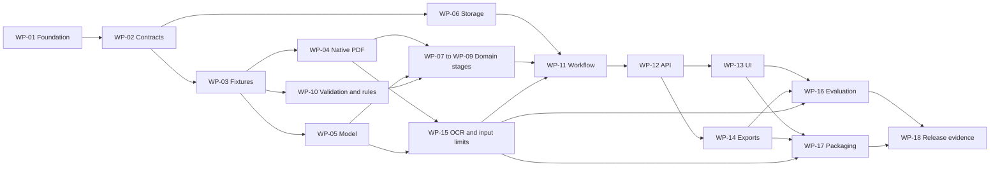

# Aira implementation work breakdown

This backlog decomposes the [implementation milestones](implementation-plan.md#implementation-sequence) into assignable changes. The [business requirements](requirements/business-requirements.md) define the staff outcome, the [technical requirements](requirements/technical-requirements.md) define testable system behavior, and the [architecture](architecture.md) defines component boundaries. Acceptance IDs refer to the existing [evaluation matrix](evaluation.md#required-scenarios).

The table below owns implementation status, dependencies, and responsibility. Individual [feature specifications](features/README.md) contain business/technical requirements, task checklists, deliverables, and acceptance details. As of October 18, 2026, all non-live packages are implemented: WP-01–WP-04, WP-06, WP-10, WP-12, WP-13, and WP-14 are complete, and WP-15–WP-18 are in progress. WP-05 live model evaluation remains blocked by API project quota, deferred at the user’s request; every live-model or live-delivery acceptance gate stays open. An owner role indicates responsibility, not an assigned person. No delivery date or effort estimate is implied before the first feasibility results.

## Work packages and dependencies

Dependencies mean the evidence needed to finish a package. Exploratory implementation can start earlier against agreed fixtures, but cannot be marked complete on mocked integration alone. Shared schemas are versioned: WP-02 establishes the initial baseline; WP-04, WP-05, and WP-15 may require reviewed amendments before downstream integration.

| ID | Work package | Milestone | Owner role | Depends on | Technical requirements | Status |
| --- | --- | --- | --- | --- | --- | --- |
| WP-01 | [Repository foundation and executable checks](features/01-repository-foundation.md) | M0 | Integration | Current documentation | TR-017, TR-018 | Complete |
| WP-02 | [Domain and interface contract baseline](features/02-domain-contracts.md) | M0 | Backend/integration | WP-01 | TR-001–TR-015 | Complete |
| WP-03 | [Annotated fixtures and expected outcomes](features/03-evaluation-fixtures.md) | M0 | Evaluation | WP-02 | TR-017 | Complete |
| WP-04 | [Native PDF extraction experiment](features/04-pdf-ingestion-extraction.md) | M2 | Documents | WP-02, WP-03 | TR-001, TR-002 | Complete |
| WP-05 | [Model feasibility and OpenAI adapter](features/05-model-integration.md) | M1 | Model integration | WP-02, WP-03 | TR-010, TR-016 | Blocked |
| WP-06 | [Local storage and artifact identity](features/06-versioned-storage.md) | M3 | Backend | WP-02 | TR-012 | Complete |
| WP-07 | [Request context and applicability](features/07-request-applicability.md) | M3 | Domain | WP-04, WP-05, WP-10 | TR-004, TR-005 | In progress |
| WP-08 | [Policy requirements and completeness](features/08-policy-interpretation.md) | M3 | Domain | WP-04, WP-05, WP-10 | TR-006 | In progress |
| WP-09 | [Chart facts and criterion evidence](features/09-chart-evidence.md) | M3 | Domain | WP-04, WP-05, WP-10 | TR-007 | In progress |
| WP-10 | [Provenance validation and rule evaluator](features/10-rule-validation.md) | M3 | Domain | WP-02, WP-03 | TR-008, TR-009 | Complete |
| WP-11 | [Assessment workflow and recovery](features/11-assessment-workflow.md) | M3 | Integration | WP-06, WP-07, WP-08, WP-09, WP-10, WP-15 | TR-011, TR-016 | In progress |
| WP-12 | [HTTP and source inspection API](features/12-http-source-api.md) | M3–M4 | Backend | WP-04, WP-06, WP-11 | TR-013 | Complete |
| WP-13 | [Staff upload and review interface](features/13-staff-review-interface.md) | M4 | Frontend | WP-12 | TR-014 | Complete |
| WP-14 | [Traceable assessment exports](features/14-assessment-exports.md) | M4 | Backend/frontend | WP-11, WP-12 | TR-015 | Complete |
| WP-15 | [OCR decision and supported input limits](features/15-ocr-input-limits.md) | M2 | Documents/model integration | WP-03, WP-04, WP-05 | TR-003, TR-016 | In progress |
| WP-16 | [Integrated evaluation and regression checks](features/16-evaluation-regression.md) | M5 | Evaluation/integration | WP-13, WP-14, WP-15 | TR-017 | In progress |
| WP-17 | [Container packaging and reviewer setup](features/17-reviewer-packaging.md) | M6 | Integration | WP-05, WP-12, WP-13, WP-14, WP-15 | TR-010, TR-018 | In progress |
| WP-18 | [Release verification and design note](features/18-release-handoff.md) | M6 | Integration | WP-16, WP-17 | TR-017, TR-018 | In progress |

WP-07, WP-08, and WP-09 can be developed independently using the request, policy, and evidence contracts from WP-02 and annotated examples from WP-03. Their runtime order is enforced by WP-11: scope first, then policy interpretation, then evidence mapping. A chart-only extraction test can inspect the supplied chronology even though its end-to-end pair stops at mismatch.

The diagram summarizes the flow; the dependency table is authoritative. The principal integration path is contracts and fixtures → validated parser/provider/domain stages → workflow/API → staff review → release evidence. Storage, pure rules, and the native-text input-limit decision can progress alongside that path. Final delivery requires both evaluated behavior and a clean packaged launch.

## Package definitions

The detailed scope and execution checklists live in the linked feature files. These anchors preserve package references from requirements and design documents.

### WP-01 Repository foundation

[Feature specification and implementation checklist](features/01-repository-foundation.md).

### WP-02 Domain and interface contracts

[Feature specification and implementation checklist](features/02-domain-contracts.md).

### WP-03 Annotated fixtures and evaluation expectations

[Feature specification and implementation checklist](features/03-evaluation-fixtures.md).

### WP-04 Native PDF extraction

[Feature specification and implementation checklist](features/04-pdf-ingestion-extraction.md).

### WP-05 Model experiment and adapter

[Feature specification and implementation checklist](features/05-model-integration.md).

### WP-06 Storage and identity

[Feature specification and implementation checklist](features/06-versioned-storage.md).

### WP-07 Request context and applicability

[Feature specification and implementation checklist](features/07-request-applicability.md).

### WP-08 Policy interpretation and completeness

[Feature specification and implementation checklist](features/08-policy-interpretation.md).

### WP-09 Evidence mapping

[Feature specification and implementation checklist](features/09-chart-evidence.md).

### WP-10 Validation and evaluation core

[Feature specification and implementation checklist](features/10-rule-validation.md).

### WP-11 Workflow and recovery

[Feature specification and implementation checklist](features/11-assessment-workflow.md).

### WP-12 HTTP and source API

[Feature specification and implementation checklist](features/12-http-source-api.md).

### WP-13 Staff interface

[Feature specification and implementation checklist](features/13-staff-review-interface.md).

### WP-14 Exports

[Feature specification and implementation checklist](features/14-assessment-exports.md).

### WP-15 OCR and input envelope

[Feature specification and implementation checklist](features/15-ocr-input-limits.md).

### WP-16 Integrated regression and evaluation

[Feature specification and implementation checklist](features/16-evaluation-regression.md).

### WP-17 Packaging and reviewer setup

[Feature specification and implementation checklist](features/17-reviewer-packaging.md).

### WP-18 Release evidence and handoff

Design-note draft (`docs/design-note.md`); live release checks remain open.

[Feature specification and implementation checklist](features/18-release-handoff.md).

## Integration and completion rules

Use `Not started`, `In progress`, `Blocked`, or `Complete` in the status column, with a concrete reason for blocked work. Each package should fit a focused change or a small series of reviewable changes. Its completion record identifies the owner, implementing commit, requirements covered, checks run, observed results, and remaining limitations. Use actual evidence before changing status; the records below distinguish completed packages from unfinished integration and live validation.

Assign one owner to shared schemas and API examples. Document/provider/storage work can proceed in parallel after the contract baseline. Policy, evidence, and applicability work must use the same versions. Run integration checks after merging; branch-level green checks do not prove a working product.

Start with WP-01–WP-03, then run WP-04 and WP-05 alongside the pure validation/storage work. Resolve native-text input limits and explicit scan rejection in parallel. Demonstrate the CLI vertical slice before expanding the review UI. Keep hosting, policy discovery, queues, retrieval infrastructure, and payer submission out of these packages unless a documented requirement changes.

## Implementation evidence

| Package | Implementing commit and verification | Remaining boundary |
| --- | --- | --- |
| WP-01 | `f42b670`; [successful Actions run](https://github.com/alexeynesteruk/aira/actions/runs/39071755373). FastAPI/React shell, pinned toolchains, lint/type/tests/build, Docker and browser gates, checksummed image delivery. A deliberate TypeScript error was rejected locally. | The delivered image now serves the full UI/API; live in-container processing is WP-17's remaining gate. |
| WP-02 | `28da09e`; [successful Actions run](https://github.com/alexeynesteruk/aira/actions/runs/39072343066). Versioned records, 45 contract checks, [contract documentation](contracts.md). Integration owner maintains shared schemas. | Provider schema compatibility and domain interpretation need live verification. |
| WP-03 | `eff3124`; [successful Actions run](https://github.com/alexeynesteruk/aira/actions/runs/39072616016). 23 corpus checks and [independent source review](reviews/wp03-fixtures.md). A follow-up commit adds the rendered development PDFs (`examples/synthetic/`), manifest, integrity checks, and the FT-01 construction-ledger update. | These are text fixtures and reviewed expectations, not a semantic benchmark. The reserved pair is not claimed blind; final release inputs still need independent curation. |
| WP-04 | Implemented in b615da6, verified by [CI](https://github.com/alexeynesteruk/aira/actions/runs/39112341365); [extraction record](results/pdf-extraction.md), 34 integration checks on the supplied chart and both guideline snapshots. | Persistence/workflow use is in WP-06/WP-11; the measured model envelope is in WP-15. |
| WP-05 | Blocked: the adapter and isolated-stage CLI are implemented (fac0c9a, [CI](https://github.com/alexeynesteruk/aira/actions/runs/39112341365)) and the [provider experiment record](results/model-feasibility.md) separates controlled checks from the observed quota failure, but live structured output, model comparison, and timing need API project quota, which the user deferred on October 18. | No tested model selection or live stage output exists. |
| WP-06 | Implemented in 1594ec1, verified by [CI](https://github.com/alexeynesteruk/aira/actions/runs/39112341365); [storage record](results/storage.md), 30 integration checks on real SQLite/filesystem state. | Workflow integration is in WP-11. |
| WP-07–WP-09 | Candidate conversion in `app.policies` with 52 checks (7526a77, [CI](https://github.com/alexeynesteruk/aira/actions/runs/39112341365)) and the production `app.llm.interpreter.OpenAIStageInterpreter` wiring adapter/prompts to conversion with 12 mocked-transport checks (570a0e1, [CI](https://github.com/alexeynesteruk/aira/actions/runs/39113104389); [stage interpreter record](results/stage-interpreter.md)). | Live semantic checks remain blocked by the deferred quota; the annotated fixture and comparison tasks are open. |
| WP-10 | Implemented in 4fda3b1, verified by [CI](https://github.com/alexeynesteruk/aira/actions/runs/39112341365); [rules record](results/rules.md), 140 pure validation/evaluation checks. | Semantic evaluation is in WP-16. |
| WP-11 | Engine and rendered-input checks in 7526a77 and 54986e5 ([CI](https://github.com/alexeynesteruk/aira/actions/runs/39112341365)); the production stage interpreter landed in 570a0e1 ([CI](https://github.com/alexeynesteruk/aira/actions/runs/39113104389)); application startup wiring landed in f92c4fd ([CI](https://github.com/alexeynesteruk/aira/actions/runs/39114147676)). | [workflow record](results/workflow.md); the live run remains quota-blocked. |
| WP-12 | Implemented in f92c4fd, verified by [CI](https://github.com/alexeynesteruk/aira/actions/runs/39114147676); typed OpenAPI and persisted provider verification added in 9f3c368 ([CI](https://github.com/alexeynesteruk/aira/actions/runs/39122282423)); [HTTP API record](results/http-api.md), 19 API checks plus 3 health checks over the real lifespan, store, and engine. | The staff review UI in WP-13 is the consumer. |
| WP-13 | Implemented in e5bb91a, verified by [CI](https://github.com/alexeynesteruk/aira/actions/runs/39115133880); contrary/satisfied journeys plus the OR-path, failed-page, and verification-state work landed in 9f3c368 ([CI](https://github.com/alexeynesteruk/aira/actions/runs/39122282423)); [review UI record](results/review-ui.md), 9 saved fixture journeys plus 23 frontend checks. | WP-16 live parity remains open. |
| WP-14 | Markdown export renderer in `app.assessment.export` with 5 checks (7526a77, [CI](https://github.com/alexeynesteruk/aira/actions/runs/39112341365)); export routes in `app.api` proven for JSON/Markdown, state conflicts, and cross-run stability (f92c4fd, [CI](https://github.com/alexeynesteruk/aira/actions/runs/39114147676)); UI downloads verified against filenames and persisted content (e5bb91a, [CI](https://github.com/alexeynesteruk/aira/actions/runs/39115133880)); evaluation-path lines added in 9f3c368 ([CI](https://github.com/alexeynesteruk/aira/actions/runs/39122282423)). | WP-16 UI parity against live runs remains the open boundary. |
| WP-15 | Declared boundary and limit evidence in [input limits record](results/input-limits.md); parser byte/page/character limits and intake rejection classes verified at API level in [results/http-api.md](results/http-api.md) and [results/pdf-extraction.md](results/pdf-extraction.md). | The parser-plus-model token envelope needs live calls and stays open under the deferred quota. |
| WP-16 | Deterministic checks (lint/type/build/pytest/Vitest) run on every push (latest [CI](https://github.com/alexeynesteruk/aira/actions/runs/39122282423)); controlled-interpreter and fixture-interpreter checks exercise failure, interruption, annotation conflict, cache invalidation, source navigation, and export parity. A follow-up commit renders the development corpus to native-text PDFs (FT-01) and updates the construction ledger. | The live semantic evaluation report, release-corpus expectations, and the live A19 run remain open. |
| WP-17 | Container delivery verified on every main push (latest [CI](https://github.com/alexeynesteruk/aira/actions/runs/39115133880)); the reviewer docs and compose volume landed in e5bb91a, and persisted preflight verification plus `AIRA_MAX_OUTPUT_TOKENS` landed in 9f3c368 ([CI](https://github.com/alexeynesteruk/aira/actions/runs/39122282423)). | The live in-container upload-to-export check (A19) remains open until quota is restored. |
