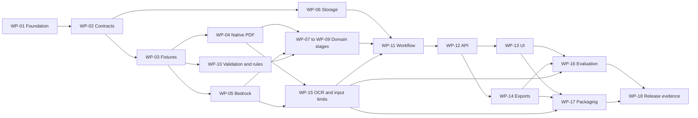

# Aira implementation work breakdown

This backlog decomposes the [implementation milestones](implementation-plan.md#implementation-sequence) into assignable changes. The [business requirements](requirements/business-requirements.md) define the staff outcome, the [technical requirements](requirements/technical-requirements.md) define testable system behavior, and the [architecture](architecture.md) defines component boundaries. Acceptance IDs refer to the existing [evaluation matrix](evaluation.md#required-scenarios).

All work packages below are **not started** as of October 18, 2026. Documentation and research are complete; application code and live validation are not. An owner role indicates responsibility, not an assigned person. No delivery date or effort estimate is implied before the first feasibility results.

## Work packages and dependencies

Dependencies mean the evidence needed to finish a package. Exploratory implementation can start earlier against agreed fixtures, but cannot be marked complete on mocked integration alone. Shared schemas are versioned: WP-02 establishes the initial baseline; WP-04, WP-05, and WP-15 may require reviewed amendments before downstream integration.

| ID | Work package | Milestone | Owner role | Depends on | Technical requirements |
| --- | --- | --- | --- | --- | --- |
| WP-01 | Repository foundation and executable checks | M0 | Integration | Current documentation | TR-017, TR-018 |
| WP-02 | Domain and interface contract baseline | M0 | Backend/integration | WP-01 | TR-001–TR-015 |
| WP-03 | Annotated fixtures and expected outcomes | M0 | Evaluation | WP-02 | TR-017 |
| WP-04 | Native PDF extraction experiment | M2 | Documents | WP-02, WP-03 | TR-001, TR-002 |
| WP-05 | Bedrock feasibility and provider adapter | M1 | Model integration | WP-02, WP-03 | TR-010, TR-016 |
| WP-06 | Local storage and artifact identity | M3 | Backend | WP-02 | TR-012 |
| WP-07 | Request context and applicability | M3 | Domain | WP-04, WP-05, WP-10 | TR-004, TR-005 |
| WP-08 | Policy requirements and completeness | M3 | Domain | WP-04, WP-05, WP-10 | TR-006 |
| WP-09 | Chart facts and criterion evidence | M3 | Domain | WP-04, WP-05, WP-10 | TR-007 |
| WP-10 | Provenance validation and rule evaluator | M3 | Domain | WP-02, WP-03 | TR-008, TR-009 |
| WP-11 | Assessment workflow and recovery | M3 | Integration | WP-06, WP-07, WP-08, WP-09, WP-10, WP-15 | TR-011, TR-016 |
| WP-12 | HTTP and source inspection API | M3–M4 | Backend | WP-04, WP-06, WP-11 | TR-013 |
| WP-13 | Staff upload and review interface | M4 | Frontend | WP-12 | TR-014 |
| WP-14 | Traceable assessment exports | M4 | Backend/frontend | WP-11, WP-12 | TR-015 |
| WP-15 | OCR decision and supported input limits | M2 | Documents/model integration | WP-03, WP-04, WP-05; Textract access if trialing OCR | TR-003, TR-016 |
| WP-16 | Integrated evaluation and regression checks | M5 | Evaluation/integration | WP-13, WP-14, WP-15 | TR-017 |
| WP-17 | Container packaging and reviewer setup | M6 | Integration | WP-05, WP-12, WP-13, WP-14, WP-15 | TR-010, TR-018 |
| WP-18 | Release verification and design note | M6 | Integration | WP-16, WP-17 | TR-017, TR-018 |

WP-07, WP-08, and WP-09 can be developed independently using the request, policy, and evidence contracts from WP-02 and annotated examples from WP-03. Their runtime order is enforced by WP-11: scope first, then policy interpretation, then evidence mapping. A chart-only extraction test can inspect the supplied chronology even though its end-to-end pair stops at mismatch.

The diagram summarizes the flow; the dependency table is authoritative. The principal integration path is contracts and fixtures → validated parser/provider/domain stages → workflow/API → staff review → release evidence. Storage, pure rules, and the OCR decision can progress alongside that path. Final delivery requires both evaluated behavior and a clean packaged launch.

## Package definitions

### WP-01 Repository foundation

Create the Python and TypeScript project skeletons, dependency locks, local configuration example, and actual lint/type/test/build entry points. Keep a minimal application shell runnable while the domain work proceeds. Add CI for the commands that exist; it must not require AWS credentials for ordinary pull-request checks.

Deliver `backend/pyproject.toml`, the frontend package configuration, lockfiles, initial app entry points, and a CI workflow. Done means installation and the empty shell's build/checks run from documented commands, with no placeholder success claims. This is foundation evidence for A19, not a completed live product.

### WP-02 Domain and interface contracts

Implement the versioned document/span, request/annotation, policy/node, fact, finding, run, and error contracts. Define workflow status separately from processing phase and assessment outcome. Draft API examples and a provider-compatible flat schema alongside stricter local invariants. Keep policy rules as data.

Deliver `backend/app/schemas/`, documented API examples, and contract tests rejecting invalid IDs, unsupported states, and malformed references. The same fixture contracts support parser, model, evaluator, and UI work. Record any later schema change and update consumers together. Relevant cases: A07, A12, A15–A17, A20.

### WP-03 Annotated fixtures and evaluation expectations

Create fictional matched vascular charts, missing/negative/conflicting variants, a controlled changed-policy case, and a second policy family. Preserve exact source hashes and manually reviewed expected scope, criteria, logical edges, and evidence spans. Separate development examples from held-out release inputs. Use the supplied pair for mismatch and its chart for stage-specific chronology checks.

Deliver `tests/fixtures/`, `evals/cases/`, and `evals/expected/` with source and annotation provenance. Done means each applicable A01–A20 scenario has an input or a concrete fixture-construction task, and the core matched/mismatched/uncertain expectations already exist before prompt tuning. No generated expectation may silently serve as its own ground truth.

### WP-04 Native PDF extraction

Build page-aware extraction with immutable byte hashes, page/block identity, layout information, and per-page quality assessment. Check columns, tables, units, negation, dates, and page-spanning passages against rendered source pages. Validate file type, malformed/encrypted input, blank pages, and declared size limits.

Deliver `backend/app/documents/` and a short extraction report identifying tested parser settings and limitations. Done means every page is accounted for, important sample facts retain their context, and failed extraction never returns an ordinary completed assessment. Relevant cases: A05 at the extraction stage, A10, A13–A15. OCR support is decided in WP-15.

### WP-05 Bedrock experiment and adapter

Implement the narrow model interface, structured-output transport, versioned prompts, configuration validation, and bounded call behavior. Use fixed page-tagged fixture text so this experiment does not wait for the production PDF parser. Compare accessible candidates and record any single-model limitation. Verify actual model/profile, region, schema support, and credential onboarding.

Deliver `backend/app/llm/`, an experiment command, recorded quality/usage/latency results, and the selected model configuration. Done means a real invocation validates against the contracts, the tested SDK version is pinned, and denied access/refusal/timeout/invalid output produce distinguishable failures. Tests may use recorded responses; the live result must be identified separately. Relevant cases: A02–A05, A15–A18, plus the AWS portion of A19.

### WP-06 Storage and identity

Implement SQLite repositories and local artifact storage for original inputs, extraction outputs, run metadata, and validated results. Use explicit document roles and run references. Fingerprints include the versions and inputs that affect each artifact; assessment identity also includes the request and staff annotations.

Deliver `backend/app/storage/` and persistence tests. Done means results reload, changed inputs/configuration create distinct lineage, wrong-document references are rejected, and only compatible completed artifacts can be reused. Failed/interrupted attempts remain visible. Relevant cases: A09, A15, A17.

### WP-07 Request context and applicability

Extract one procedure request with payer/plan, anatomical target/laterality, date roles, and available scope evidence. Store staff clarification separately from the original facts. Evaluate supported scope and exclusions before medical-necessity aggregation.

Deliver scoped request/applicability functions and annotated outputs. Done means the supplied pair stops with a cited mismatch, unknown scope stops for input, and unrelated sides/procedures or ambiguous effective dates are never silently selected. Scope clarification creates a new linked run, retaining any original conflict and the explicit reason for a metadata resolution. An annotation cannot manufacture chart-supported clinical evidence. Relevant cases: A01, A10, A12, A15, A17.

### WP-08 Policy interpretation and completeness

Extract criteria, AND/OR groups, definitions, applicable exceptions, and a relevant-section inventory. Use flat node references and preserve source wording. Relate each governing condition to a supported rule or an explicit unresolved issue. Develop against selected-request fixtures while WP-07 is being integrated.

Deliver `backend/app/policies/`, versioned prompts, and expected-tree comparisons. Done means branch-specific conditions remain local to their branch, mandatory conditions cannot be knowingly dropped, and unsupported prose blocks favorable readiness even if the extracted tree is true. Relevant cases: A06, A08–A11, A20.

### WP-09 Evidence mapping

Extract and map chart facts to the selected request and supplied criteria. Preserve polarity, units, event/documentation dates, relevant cutoff, repeated claims, and conflicting alternatives. A summary assertion keeps its summary provenance instead of acquiring invented underlying measurements.

Deliver `backend/app/evidence/`, versioned prompts, and annotated fact/finding comparisons. Done means matched, missing, contrary, conflicting, wrong-side, post-cutoff, and unrelated-evidence cases retain the correct distinctions and supporting spans. Relevant cases: A02–A05, A08, A12, A15, A18.

### WP-10 Validation and evaluation core

Implement source-span resolution, domain validation, graph validation, supported numeric/date predicates, and true/false/unknown AND/OR evaluation. Preserve child findings and unresolved reasons independently of logical value. Apply completeness, applicability, and unsupported-interpretation blockers outside the tree result.

Deliver pure functions in `policies/`, `evidence/`, and `assessment/` with direct tests. Done means truth tables, units and boundary cases, bad citations, cycles, missing nodes, unclassified mandatory conditions, and plausible broken variants fail or pass as specified. No model, HTTP server, or AWS account is required for these checks. Relevant cases: A06–A08, A15, A20.

### WP-11 Workflow and recovery

Connect the independently tested stages in the required order. Persist queued/running/needs-input/completed/failed/interrupted states, stage artifacts, timings, attempts, and provider usage. Bound concurrency and stage work. Stop on mismatch or unknown scope, and prevent unsupported/partial outputs from becoming successful findings.

Deliver `backend/app/assessment/` workflow and execution records. Done means a live CLI vertical slice completes a matched case, exposes gaps, stops the supplied mismatch, and handles dependency errors/restart without losing provenance. A retry creates a new attempt and reuses only compatible validated artifacts. Relevant cases: A01–A05, A16, A17, A20.

### WP-12 HTTP and source API

Expose the [TRD interface contract](requirements/technical-requirements.md) for uploads, assessment creation/status, original source access, and health/readiness. Perform bounded intake validation and page counting at upload; full extraction and model work run asynchronously after assessment creation. Return a run ID promptly. Serve the source bytes tied to the selected run and preserve one-based page navigation semantics.

Deliver `backend/app/api/`, generated API documentation, and boundary tests. Done means malformed/oversized input, invalid document roles, wrong IDs, absent configuration, progress, and terminal results have the specified responses. Readiness checks do not trigger repeated paid inference. Relevant cases: A01, A12–A17, A19.

### WP-13 Staff interface

Implement upload, request summary, scope clarification, applicability outcome, grouped checklist, actionable issues, source navigation, and retry. Use frozen API examples for early UI work, then verify against the real API. Prioritize source passages and next documentation actions; retain technical traces in an inspection view.

Deliver `frontend/src/features/` and saved browser journeys. Done means a staff reviewer can inspect both policy and chart citations, distinguish evidence states, resolve request scope without rewriting source facts, and recover from a useful error. Relevant cases: A01–A05, A12, A13, A16, A19. Export generation belongs to WP-14; its download action is integrated here.

### WP-14 Exports

Generate JSON and a readable checklist from the persisted assessment without another model call. Include exact input/version identities, request context, findings, citations, unresolved issues, and run provenance. Export an unresolved outcome honestly; exclude credentials and internal secrets.

Deliver export functions, API routes under the TRD contract, and UI download integration. Done means exported findings match the saved result, retain source references, and remain tied to their original run after a later assessment changes. Relevant cases: A09, A17, A19.

### WP-15 OCR and input envelope

Trial selective pagewise Textract on scanned and mixed PDFs if AWS access permits. Verify original-page remapping, layout/table relationships, and cross-page reconstruction. Record the final page/byte/token limits using both parser and Bedrock experiment results. OCR exploration can proceed alongside WP-05, but the combined input envelope is complete only after both experiments. Select either verified OCR support or a clear text-only release boundary; the decision is mandatory, the OCR adapter is conditional.

Deliver the input-support decision and fixtures; include an OCR adapter only if it passes. Done means the selected path handles A13/A14 honestly and never skips a failed page. Failure to obtain Textract access does not block a clearly scoped text-only MVP, but it cannot be reported as tested OCR support. Bedrock access for live assessment remains required.

### WP-16 Integrated regression and evaluation

Run the evaluation matrix on the integrated workflow and UI. Include the second policy family, policy changes, independent expected outcomes, negative controls, and selected repeated model trials. Add CI checks for the integrated build and deterministic tests. Keep live AWS evaluations separately invoked and versioned.

Deliver an evaluation report with commit/configuration/input identities, counts, failures, and observed latency/usage. Done means the [release gates](evaluation.md#metrics-and-release-gates) pass on the stated corpus or a narrower supported scope is explicitly documented and retested. Testing belongs in every earlier package; this package checks the combined result. Relevant cases: A01–A20, with A19 finalized in WP-18.

### WP-17 Packaging and reviewer setup

Package the React build and FastAPI application in one image, define the persistent volume and port, and document temporary AWS credentials/configuration. Include parser dependencies and locked application dependencies. Keep the UI available to explain a missing model configuration without fabricating a result.

Deliver `Dockerfile`, `compose.yaml`, `.env.example`, and the actual one-line launch instructions. Done means the command boots and a new upload reaches real Bedrock with only documented prerequisites. A fixture mode is labeled as such. Relevant case: A19. Begin packaging early enough to expose platform and credential problems; WP-18 provides independent clean-checkout evidence.

### WP-18 Release evidence and handoff

Run the exact launch command from a fresh checkout, exercise a separately held-out document pair, inspect citations/exports, and record actual results. Write the short design note from observed tradeoffs, supported limits, and failures. Prepare the repo or zip and a concise demonstration of a successful case and a useful failure.

Deliver a release-verification record, final README, design note, and submission-ready revision. Done means no critical release blocker remains, the handoff contains the command and prerequisites, and the code is ready to reach assessors at least one day before the scheduled call. The call date and delivery channel must be confirmed before any external send; this task does not authorize messaging assessors. Relevant cases: A11, A19 and the complete release checklist.

## Integration and completion rules

Each package should fit a focused change or a small series of reviewable changes. Its completion record identifies the owner, implementing commit, requirements covered, checks run, observed results, and remaining limitations. Use actual evidence before changing status; this backlog is not a record of successful implementation.

Assign one owner to shared schemas and API examples. Document/provider/storage work can proceed in parallel after the contract baseline. Policy, evidence, and applicability work must use the same versions. Run integration checks after merging; branch-level green checks do not prove a working product.

Start with WP-01–WP-03, then run WP-04 and WP-05 alongside the pure validation/storage work. Resolve the OCR/input-envelope decision in parallel. Demonstrate the CLI vertical slice before expanding the review UI. Keep hosting, policy discovery, queues, retrieval infrastructure, and payer submission out of these packages unless a documented requirement changes.
