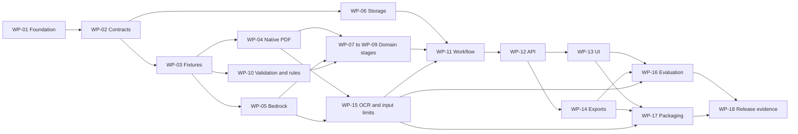

# Aira implementation work breakdown

This backlog decomposes the [implementation milestones](implementation-plan.md#implementation-sequence) into assignable changes. The [business requirements](requirements/business-requirements.md) define the staff outcome, the [technical requirements](requirements/technical-requirements.md) define testable system behavior, and the [architecture](architecture.md) defines component boundaries. Acceptance IDs refer to the existing [evaluation matrix](evaluation.md#required-scenarios).

The table below owns implementation status, dependencies, and responsibility. Individual [feature specifications](features/README.md) contain business/technical requirements, task checklists, deliverables, and acceptance details. As of October 18, 2026, these specifications are prepared; application code and live validation are not. An owner role indicates responsibility, not an assigned person. No delivery date or effort estimate is implied before the first feasibility results.

## Work packages and dependencies

Dependencies mean the evidence needed to finish a package. Exploratory implementation can start earlier against agreed fixtures, but cannot be marked complete on mocked integration alone. Shared schemas are versioned: WP-02 establishes the initial baseline; WP-04, WP-05, and WP-15 may require reviewed amendments before downstream integration.

| ID | Work package | Milestone | Owner role | Depends on | Technical requirements | Status |
| --- | --- | --- | --- | --- | --- | --- |
| WP-01 | [Repository foundation and executable checks](features/01-repository-foundation.md) | M0 | Integration | Current documentation | TR-017, TR-018 | Not started |
| WP-02 | [Domain and interface contract baseline](features/02-domain-contracts.md) | M0 | Backend/integration | WP-01 | TR-001–TR-015 | Not started |
| WP-03 | [Annotated fixtures and expected outcomes](features/03-evaluation-fixtures.md) | M0 | Evaluation | WP-02 | TR-017 | Not started |
| WP-04 | [Native PDF extraction experiment](features/04-pdf-ingestion-extraction.md) | M2 | Documents | WP-02, WP-03 | TR-001, TR-002 | Not started |
| WP-05 | [Bedrock feasibility and provider adapter](features/05-bedrock-integration.md) | M1 | Model integration | WP-02, WP-03 | TR-010, TR-016 | Not started |
| WP-06 | [Local storage and artifact identity](features/06-versioned-storage.md) | M3 | Backend | WP-02 | TR-012 | Not started |
| WP-07 | [Request context and applicability](features/07-request-applicability.md) | M3 | Domain | WP-04, WP-05, WP-10 | TR-004, TR-005 | Not started |
| WP-08 | [Policy requirements and completeness](features/08-policy-interpretation.md) | M3 | Domain | WP-04, WP-05, WP-10 | TR-006 | Not started |
| WP-09 | [Chart facts and criterion evidence](features/09-chart-evidence.md) | M3 | Domain | WP-04, WP-05, WP-10 | TR-007 | Not started |
| WP-10 | [Provenance validation and rule evaluator](features/10-rule-validation.md) | M3 | Domain | WP-02, WP-03 | TR-008, TR-009 | Not started |
| WP-11 | [Assessment workflow and recovery](features/11-assessment-workflow.md) | M3 | Integration | WP-06, WP-07, WP-08, WP-09, WP-10, WP-15 | TR-011, TR-016 | Not started |
| WP-12 | [HTTP and source inspection API](features/12-http-source-api.md) | M3–M4 | Backend | WP-04, WP-06, WP-11 | TR-013 | Not started |
| WP-13 | [Staff upload and review interface](features/13-staff-review-interface.md) | M4 | Frontend | WP-12 | TR-014 | Not started |
| WP-14 | [Traceable assessment exports](features/14-assessment-exports.md) | M4 | Backend/frontend | WP-11, WP-12 | TR-015 | Not started |
| WP-15 | [OCR decision and supported input limits](features/15-ocr-input-limits.md) | M2 | Documents/model integration | WP-03, WP-04, WP-05; Textract access if trialing OCR | TR-003, TR-016 | Not started |
| WP-16 | [Integrated evaluation and regression checks](features/16-evaluation-regression.md) | M5 | Evaluation/integration | WP-13, WP-14, WP-15 | TR-017 | Not started |
| WP-17 | [Container packaging and reviewer setup](features/17-reviewer-packaging.md) | M6 | Integration | WP-05, WP-12, WP-13, WP-14, WP-15 | TR-010, TR-018 | Not started |
| WP-18 | [Release verification and design note](features/18-release-handoff.md) | M6 | Integration | WP-16, WP-17 | TR-017, TR-018 | Not started |

WP-07, WP-08, and WP-09 can be developed independently using the request, policy, and evidence contracts from WP-02 and annotated examples from WP-03. Their runtime order is enforced by WP-11: scope first, then policy interpretation, then evidence mapping. A chart-only extraction test can inspect the supplied chronology even though its end-to-end pair stops at mismatch.

The diagram summarizes the flow; the dependency table is authoritative. The principal integration path is contracts and fixtures → validated parser/provider/domain stages → workflow/API → staff review → release evidence. Storage, pure rules, and the OCR decision can progress alongside that path. Final delivery requires both evaluated behavior and a clean packaged launch.

## Package definitions

The detailed scope and execution checklists live in the linked feature files. These anchors preserve package references from requirements and design documents.

### WP-01 Repository foundation

[Feature specification and implementation checklist](features/01-repository-foundation.md).

### WP-02 Domain and interface contracts

[Feature specification and implementation checklist](features/02-domain-contracts.md).

### WP-03 Annotated fixtures and evaluation expectations

[Feature specification and implementation checklist](features/03-evaluation-fixtures.md).

### WP-04 Native PDF extraction

[Feature specification and implementation checklist](features/04-pdf-ingestion-extraction.md).

### WP-05 Bedrock experiment and adapter

[Feature specification and implementation checklist](features/05-bedrock-integration.md).

### WP-06 Storage and identity

[Feature specification and implementation checklist](features/06-versioned-storage.md).

### WP-07 Request context and applicability

[Feature specification and implementation checklist](features/07-request-applicability.md).

### WP-08 Policy interpretation and completeness

[Feature specification and implementation checklist](features/08-policy-interpretation.md).

### WP-09 Evidence mapping

[Feature specification and implementation checklist](features/09-chart-evidence.md).

### WP-10 Validation and evaluation core

[Feature specification and implementation checklist](features/10-rule-validation.md).

### WP-11 Workflow and recovery

[Feature specification and implementation checklist](features/11-assessment-workflow.md).

### WP-12 HTTP and source API

[Feature specification and implementation checklist](features/12-http-source-api.md).

### WP-13 Staff interface

[Feature specification and implementation checklist](features/13-staff-review-interface.md).

### WP-14 Exports

[Feature specification and implementation checklist](features/14-assessment-exports.md).

### WP-15 OCR and input envelope

[Feature specification and implementation checklist](features/15-ocr-input-limits.md).

### WP-16 Integrated regression and evaluation

[Feature specification and implementation checklist](features/16-evaluation-regression.md).

### WP-17 Packaging and reviewer setup

[Feature specification and implementation checklist](features/17-reviewer-packaging.md).

### WP-18 Release evidence and handoff

[Feature specification and implementation checklist](features/18-release-handoff.md).

## Integration and completion rules

Use `Not started`, `In progress`, `Blocked`, or `Complete` in the status column, with a concrete reason for blocked work. Each package should fit a focused change or a small series of reviewable changes. Its completion record identifies the owner, implementing commit, requirements covered, checks run, observed results, and remaining limitations. Use actual evidence before changing status; this backlog is not a record of successful implementation.

Assign one owner to shared schemas and API examples. Document/provider/storage work can proceed in parallel after the contract baseline. Policy, evidence, and applicability work must use the same versions. Run integration checks after merging; branch-level green checks do not prove a working product.

Start with WP-01–WP-03, then run WP-04 and WP-05 alongside the pure validation/storage work. Resolve the OCR/input-envelope decision in parallel. Demonstrate the CLI vertical slice before expanding the review UI. Keep hosting, policy discovery, queues, retrieval infrastructure, and payer submission out of these packages unless a documented requirement changes.
